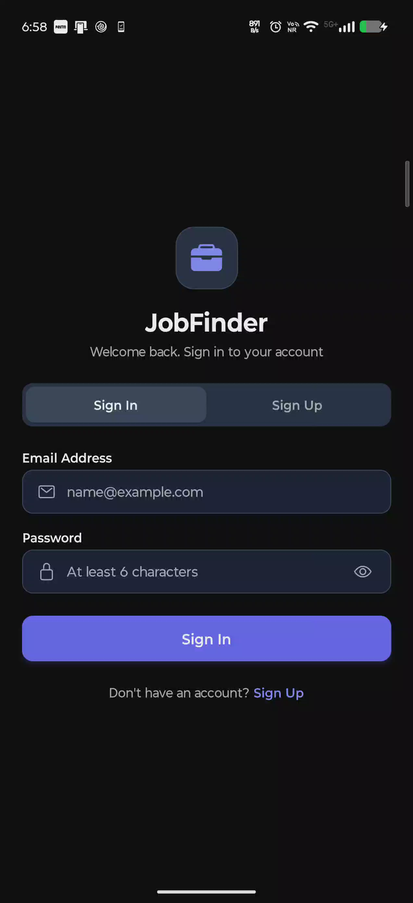
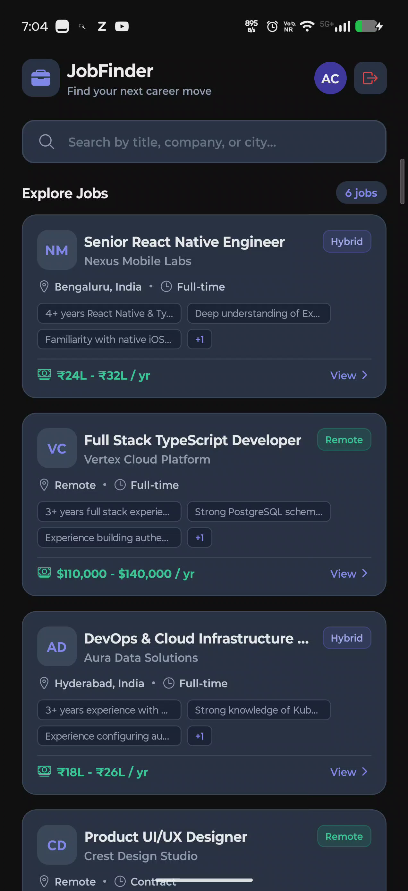
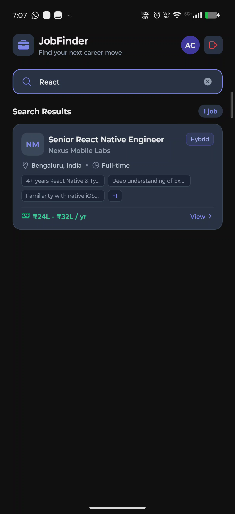
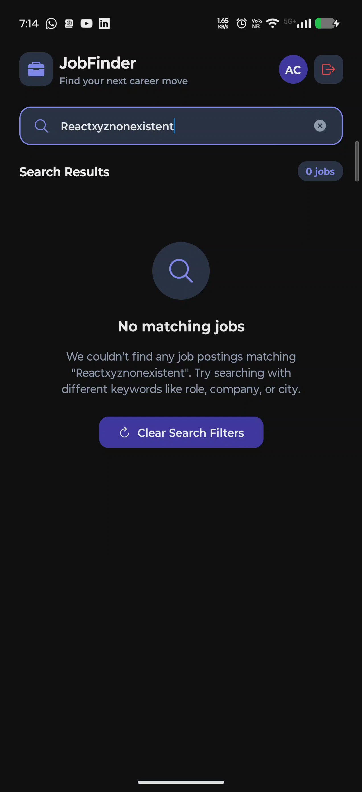
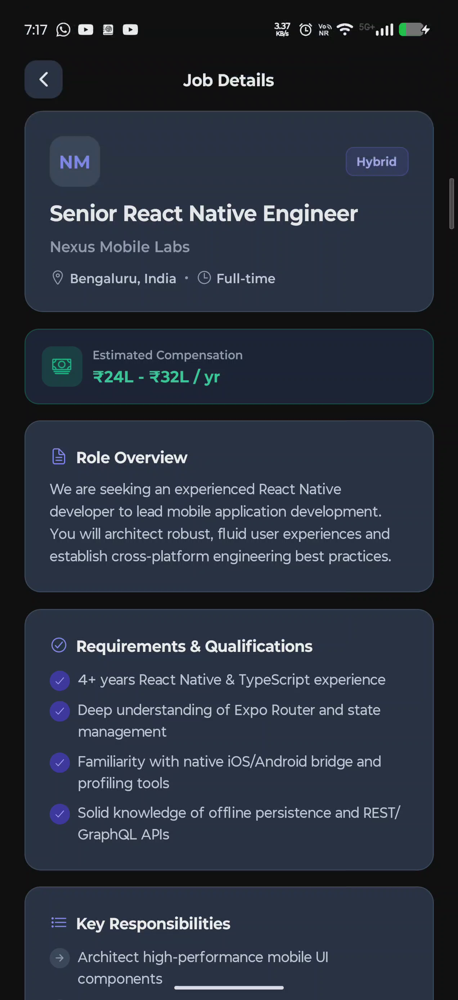
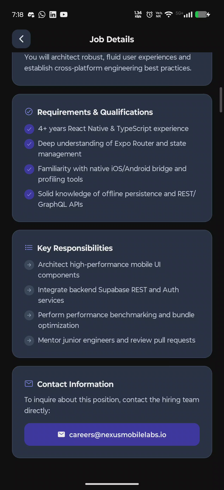

# JobFinder

> A modern, mobile-first job discovery application built with React Native, Expo SDK 58, and Supabase.

---

## 1. Project Overview

**JobFinder** is an independently developed mobile application designed to provide candidates and technology professionals with a streamlined, distraction-free job exploration experience. It connects to a live PostgreSQL backend to deliver verified tech, engineering, product, and design opportunities with transparent compensation, clear workplace models (Remote, Hybrid, On-site), structured qualifications, and direct hiring contacts.

### Assessment Context & Independence
- Developed as a practical demonstration of mobile architecture, modern React Native engineering, and full-stack backend integration.
- Built from the ground up using original code, clean architecture, and synthetic seed data.
- **Independence Notice:** JobFinder is an independent project and is not affiliated with, endorsed by, or an official product of Spire AI or iExchange.

---

## 2. Features

### Core Implemented Functionality
- **User Authentication:** Email and password registration and login with client-side validation, password masking/visibility toggling, and contextual error handling.
- **Persistent Sessions:** User sessions automatically persist in local device storage via AsyncStorage, enabling seamless auto-login on app restarts.
- **Live Supabase Job Feed:** Real-time job listings retrieved from Supabase PostgreSQL, governed by Row Level Security (RLS) policies exposing only active postings.
- **Server-Side Debounced Search:** Fast multi-field search (`title`, `company`, `location`) using a 350ms debounce window to prevent database query thrashing.
- **Comprehensive Job Details:** Dynamic route (`/job/[id]`) displaying company branding, workplace badge, compensation banner, role overview, qualification checklist, key responsibilities, and direct employer contact action.
- **Four-Tier State Handling:**
  - **Loading:** Animated pulsing skeleton cards matching the structural geometry of the content.
  - **Empty:** Query-specific empty states with actionable "Clear Search Filters" recovery.
  - **Error:** Resilient network error banners with immediate retry CTAs.
  - **Not Found:** Graceful handling for non-existent or deleted job identifiers with a direct "Return to Job Feed" CTA.
- **Pull-to-Refresh:** Smooth gesture-driven revalidation via TanStack Query and React Native `RefreshControl`.
- **Protected Navigation:** Dynamic layout routing that automatically guards private screens while preserving search queries, input focus, and scroll offsets during back navigation.

---

## 3. Tech Stack

| Technology | Version | Role in Project |
|---|---|---|
| **React Native** | `0.88.0` | Cross-platform native mobile application framework |
| **Expo** | `~58.0.19` (SDK 58) | Application development tooling, asset pipeline, and native APIs |
| **Expo Router** | `~58.0.26` | File-based typed routing, nested stack layouts, and route transitions |
| **TypeScript** | `~6.0.3` | Strict type safety across components, services, and database entities |
| **Supabase Client** | `^2.118.0` | PostgreSQL client, authentication lifecycle, and Row-Level Security |
| **TanStack Query** | `^5.104.5` | Asynchronous server-state caching, background revalidation, and query deduplication |
| **AsyncStorage** | `2.2.0` | Encrypted local session token storage across app cold boots |
| **Expo Vector Icons** | `^15.0.2` | Native iconography (`Ionicons`) for clear visual affordances |
| **ESLint & Prettier** | `^9.0.0` | Code consistency, static analysis, and Expo linting configuration |

---

## 4. Screenshots & App Walkthrough

For an in-depth walkthrough of the user journey, state transitions, and Argent interaction records, see the complete guide:

👉 **[Visual Application Walkthrough (docs/app-flow/APP-FLOW.md)](docs/app-flow/APP-FLOW.md)**

### Verified Real-Device Screenshots (Motorola Edge 70 Fusion / Android 17)

| 1. Sign In Screen | 2. Job Listings Feed | 3. Live Debounced Search |
|:---:|:---:|:---:|
|  |  |  |

| 4. Empty Search State | 5. Job Details (Top) | 6. Job Details (Bottom) |
|:---:|:---:|:---:|
|  |  |  |

> *Note: The images above represent 100% verified authentic captures (1272×2772 native PNG) from a physical Motorola Edge 70 Fusion driven via Argent MCP and validated with binary integrity checks.*

---

## 5. Getting Started

### Prerequisites
- [Node.js (LTS)](https://nodejs.org/) (Node.js >= 22.13.0 or >= 24.3.0 required for Expo SDK 58; odd-numbered releases not supported)
- [npm](https://www.npmjs.com/) (bundled with Node.js)
- A [Supabase](https://supabase.com/) account and project
- [Expo Go](https://expo.dev/go) app installed on an Android device, or an active Android emulator via Android Studio

### 1. Clone the Repository
```bash
git clone https://github.com/Ashok-Kumar-dharanikota/myjobfinder-assessment.git
cd myjobfinder-assessment
```

### 2. Install Dependencies
```bash
npm install
```

### 3. Configure Environment Variables
Copy the example environment file to `.env`:
```bash
cp .env.example .env
```
Open `.env` and fill in your Supabase project credentials:
```env
EXPO_PUBLIC_SUPABASE_URL=https://your-project.supabase.co
EXPO_PUBLIC_SUPABASE_ANON_KEY=your-anon-key
```
*(Both values can be found in your Supabase Dashboard under **Project Settings → API**).*

### 4. Database Setup & Migrations
In the Supabase Dashboard, navigate to the **SQL Editor** and execute the migration files in this exact sequence:

1. **Schema Migration:** Open and run [`supabase/schema.sql`](supabase/schema.sql)
   - Creates `profiles` and `jobs` tables.
   - Configures check constraints, indexes, and automated `updated_at` triggers.
   - Establishes Row-Level Security (RLS) policies for user data isolation.
   - Configures the `handle_new_user()` trigger for automatic profile generation on signup.

2. **Seed Data:** Open and run [`supabase/seed.sql`](supabase/seed.sql)
   - Inserts 6 verified synthetic technology opportunities across frontend, full-stack, DevOps, design, distributed systems, and mobile engineering.

> **Tip for Local Testing:** In the Supabase Dashboard under **Authentication → Providers → Email**, toggle **OFF** "Confirm email" during development to allow instant session issuance upon registration.

### 5. Start the Development Server
```bash
npx expo start
```

### 6. Run on Android Device
- Open **Expo Go** on your Android smartphone.
- Scan the QR code displayed in your terminal.
- Alternatively, if your Android device is connected via USB with USB Debugging enabled, press `a` in the terminal to launch the app automatically.

---

## 6. Project Architecture

```
myjobfinder/
├── assets/                  # App branding, splash icons, and images
├── docs/                    # Two-tier engineering and workflow documentation
│   ├── AI-WORKFLOW.md       # Master tracking dashboard and phase milestones
│   ├── app-flow/            # Visual user journey, walkthrough, and screenshots
│   │   ├── APP-FLOW.md      # Detailed screen walkthrough with Mermaid diagrams
│   │   └── screenshots/     # Verified and baseline real-device screenshots (verified/before)
│   └── workflow/            # Comprehensive chronological phase logs (Phase 0–5)
├── scripts/                 # Automated Supabase verification and test suites
│   ├── verify-phase-3.cjs   # Live query, RLS, and debounce search test suite
│   ├── verify-phase-4.cjs   # Job detail, UUID validation, and error test suite
│   └── verify-debounce.cjs  # Debounce timing and race condition test suite
├── src/                     # Application source code
│   ├── app/                 # Expo Router routes (screens & navigation)
│   │   ├── _layout.tsx      # Root layout, theme provider, and route guard
│   │   ├── index.tsx        # Home screen (Feed, App Bar, Search, FlatList)
│   │   ├── explore.tsx      # Secondary exploratory navigation route
│   │   ├── (auth)/          # Authentication route group
│   │   │   └── login.tsx    # Combined Login and Sign Up screen
│   │   └── job/             # Dynamic job item route group
│   │       └── [id].tsx     # Job detail screen with full metadata & contact
│   ├── components/          # Reusable UI presentation components
│   │   ├── job-card.tsx     # Memoized job list item card
│   │   ├── search-bar.tsx   # Persistent search input with clear trigger
│   │   ├── job-list-empty.tsx  # Empty results state with recovery CTA
│   │   ├── job-list-error.tsx  # Network query error state with retry CTA
│   │   └── job-card-skeleton.tsx # Animated pulsing skeleton loading group
│   ├── constants/           # Global design tokens and runtime configuration
│   │   ├── theme.ts         # Color palette, spacing scales, and typography
│   │   └── config.ts        # Cache timing and application constants
│   ├── context/             # Global React state providers
│   │   ├── auth-context.tsx # Supabase authentication lifecycle & session storage
│   │   └── query-provider.tsx # TanStack Query client configuration
│   ├── hooks/               # Custom React hooks
│   │   ├── use-jobs.ts      # TanStack Query hook for search & job listing
│   │   ├── use-job-detail.ts# TanStack Query hook for single-item detail caching
│   │   └── use-debounce.ts  # Generic debounce hook for search input
│   ├── services/            # Backend communication services
│   │   ├── supabase.ts      # Initialized Supabase client instance
│   │   └── jobs.service.ts  # Database queries, UUID validation, and error handling
│   └── types/               # TypeScript definitions
│       ├── job.ts           # Job posting interfaces and workplace enums
│       ├── profile.ts       # Candidate profile schema
│       └── database.types.ts# Generated Supabase database types
├── supabase/                # PostgreSQL migrations and seed scripts
│   ├── schema.sql           # Tables, constraints, RLS policies, and triggers
│   └── seed.sql             # 6 verified synthetic job listings
├── app.json                 # Expo project configuration and native metadata
├── package.json             # Dependencies, scripts, and package version locks
└── tsconfig.json            # Strict TypeScript compiler options
```

---

## 7. Technical Decisions

1. **Separation of Concerns:**
   - **Routes (`src/app/`):** Purely responsible for screen composition, parameter extraction, and navigation.
   - **Services (`src/services/`):** Encapsulates raw Supabase SDK calls, PostgreSQL query builders, and input pre-validation.
   - **Hooks (`src/hooks/`):** Bridges server state to components via TanStack Query, managing caching, stale times, and refetch states.
   - **Components (`src/components/`):** Pure, reusable presentation components designed to be stateless where possible.

2. **TanStack Query for Asynchronous State:**
   - Replaced manual `useEffect` / `useState` fetching patterns with declarative query keys (`['jobs', debouncedQuery]` and `['job', id]`).
   - Configured a 5-minute stale window (`staleTime: 1000 * 60 * 5`) to eliminate redundant network roundtrips when navigating between feed and detail views.

3. **Database-Side Search & Debouncing:**
   - Instead of downloading the full database to filter in memory, search queries execute directly on PostgreSQL using case-insensitive `ilike` filters against `title`, `company`, and `location`.
   - A 350ms custom debounce hook (`useDebounce`) ensures network requests only fire when the candidate pauses typing.

4. **Row-Level Security (RLS) & Triggers:**
   - Public access to `jobs` is strictly restricted to active records (`is_active = true`) with write operations blocked for anonymous clients.
   - A PostgreSQL trigger (`handle_new_user`) executes with `SECURITY DEFINER` privileges to automatically provision a corresponding record in `public.profiles` whenever an account is created in `auth.users`.

5. **Feed State Preservation:**
   - The search bar is deliberately positioned in a fixed header outside the scrollable `FlatList`. This prevents unmounting or focus dropping during state changes.
   - Detail view navigation uses Expo Router's `router.push()` and `router.back()`, ensuring the candidate's scroll position, active search input, and debounced filter remain intact when returning to the feed.

---

## 8. Testing & Verification

JobFinder has undergone rigorous, multi-tiered verification across all development phases:

### Automated Verification Suites
- **TypeScript Static Analysis:** Verified with zero type errors:
  ```bash
  npx tsc --noEmit
  ```
- **Linting & Code Style:** Verified with zero ESLint warnings:
  ```bash
  npx expo lint
  ```
- **Live Database Integration Tests:**
  Execute integration suites against your configured Supabase project using Node's native environment loader:
  - [`scripts/verify-phase-3.cjs`](scripts/verify-phase-3.cjs) — 9 automated checks verifying Supabase active job retrieval, multi-field search (`React`, `Aura`, `Remote`, `Pune`), comma handling, empty state responses, and RLS exclusion of inactive records:
    ```bash
    node --env-file=.env scripts/verify-phase-3.cjs
    ```
  - [`scripts/verify-phase-4.cjs`](scripts/verify-phase-4.cjs) — 16 automated checks verifying single-job UUID fetching, required metadata fields, `.maybeSingle()` non-existent handling, malformed UUID rejection, and search regression tests:
    ```bash
    node --env-file=.env scripts/verify-phase-4.cjs
    ```
  - [`scripts/verify-debounce.cjs`](scripts/verify-debounce.cjs) — 3 automated timing checks confirming search debounce thresholds and query coalescing:
    ```bash
    node scripts/verify-debounce.cjs
    ```

### Physical Device Verification (Expo Go)
- Manually tested on physical Android hardware across full authentication lifecycles (registration, login, sign out), live database search, pull-to-refresh, deep-item inspection, and cold-boot session restoration.

### Argent Mobile Automation
- Injected real touch gestures, text entry, keyboard dismissals, swipe scrolling, and deep-link routing on a connected **Motorola Edge 70 Fusion** (Android 17 / API Level 37) via Argent MCP, capturing all 9 baseline visual states documented in [`docs/app-flow/APP-FLOW.md`](docs/app-flow/APP-FLOW.md).

### Impeccable Design Audit
- Code-level and visual UI/UX design audit conducted against native Android Material 3 guidelines ([`docs/workflow/phase-5-polish-verification.md`](docs/workflow/phase-5-polish-verification.md)), establishing the visual roadmap for semantic tokenization and touch target enhancements.

---

## 9. AI-Assisted Development

This application was developed through a pair-programming workflow with **Antigravity** (Google DeepMind's advanced coding assistant). Development adhered strictly to the disciplined engineering principles outlined in [`AGENTS.md`](AGENTS.md):

- **Phase Management:** Work was organized into 6 clear milestones (Phase 0: Planning, Phase 1: Foundation, Phase 2: Database & Auth, Phase 3: Job Listing & Search, Phase 4: Job Detail, Phase 5: Verification & Polish).
- **Zero Hallucination Policy:** No phase was declared complete without reproducible proof (passing test scripts, compiler checks, and hardware validation).
- **Two-Tier Continuous Documentation:** Every single user prompt, architectural decision, and verification result was chronologically recorded in [`docs/workflow/`](docs/workflow/) and summarized on the master tracking dashboard in [`docs/AI-WORKFLOW.md`](docs/AI-WORKFLOW.md).

---

## 10. Known Limitations

- **Email Synchronization:** In the current database schema, subsequent modifications to a user's email inside Supabase Auth do not automatically sync to the `profiles` table.
- **Deferred Feature Backlog:** The following optional features were intentionally deferred post-core to prioritize architectural reliability and core user journeys:
  - Bookmarking and saved job records (`saved_jobs` table)
  - In-app job application submission workflow
  - Multi-criteria filter modal (filtering by salary slider, experience level, workplace mode)
  - Candidate profile editing and avatar uploads
  - Unauthenticated guest browsing mode

---

## License

This project is licensed under the MIT License — see the [LICENSE](LICENSE) file for details.
